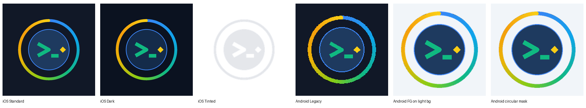

# MiniPilot

[](LICENSE)
[](#get-minipilot)

**A private, on-device AI agent for Android and iOS.**

**English** · [中文](#中文)

MiniPilot puts Claude, GPT, Gemini, OpenRouter and xAI models inside a native
mobile agent that has a real computer to work with: an Alpine Linux shell
running on the device, browser automation, skills, persistent memory, voice,
music, scheduled tasks and deep system integration. It is free and fully open
source under GPLv3.

MiniPilot is an **Android-first fork of [OpenMinis](https://github.com/OpenMinis/OpenMinis)**.
The Android line is where daily development happens — the current build is
`1.20-dev` (build 51). The iOS app remains in-tree and buildable; upstream
releases live at [openminis.app](https://openminis.app).

> **Compatibility contract** — MiniPilot keeps the identifiers that carry user
> data and deep links: the Android package `com.openminis.app` (perf builds use
> `.dev`), the `minis://` URL scheme, `/var/minis` paths and `minis-*` CLIs.
> Changing them would orphan existing sessions, skills and backups.

[**Download the Android APK**](https://github.com/zhrl55-svg/MiniPilot/releases) ·
[**Upstream iOS app**](https://apps.apple.com/app/id6759188481)



---

## What it does

| | |
|---|---|
| **Bring your own model** | Anthropic Claude, OpenAI (Chat Completions, Responses API, Azure), Google Gemini, OpenRouter and xAI, plus any OpenAI-compatible endpoint. API keys, and account sign-in where the provider supports it. |
| **A real Linux shell** | Alpine Linux runs on-device — PRoot on Android, iSH on iOS. Persistent shell, PTY, package installs, real files, mounted folders and `minis://` resources. |
| **Agent runtime** | Skills (`SKILL.md`), persona and persistent memory with hybrid retrieval, sub-agent helpers, scheduled runs, MCP servers over HTTP / SSE / STDIO, and risk-aware confirmation before destructive actions. |
| **Device integration** | Android: notifications, calendar, alarms, clipboard, media, accessibility-driven UI automation and optional Shizuku offloads. iOS: HealthKit, Calendar, Reminders, Contacts, HomeKit and more. |
| **Voice** | On-device SenseVoice speech recognition on Android, provider ASR/TTS, wake-word interaction, sentence-split read-aloud, and spoken confirmation for ambiguous commands. |
| **Web & knowledge** | Browser automation, Brave-backed web search, news, weather, stock quotes and 12306 train availability. |
| **Music** | A built-in NetEase-backed player docked above the chat, controllable by voice without leaving the conversation. |
| **Backup & portability** | Encrypted backup and restore of chats, files, providers and memories to SMB / WebDAV / SFTP / S3 / FTP via rclone; provider configuration import/export. |
| **Visibility** | Token usage per provider, in-app logs, local-only crash capture, and a JSON-RPC debug server in developer builds. |
| **20+ UI languages** | Including Simplified and Traditional Chinese, English, Japanese, Korean, German, French, Spanish, Portuguese, Russian and more. |

## What this fork adds

- **Android-first iteration.** Builds are exercised on physical devices, with an
  in-app stable/beta updater pointed at this repository's releases.
- **A distinct identity.** MiniPilot naming and the “Convergence” icon set on
  both platforms, while every compatibility identifier stays unchanged.
- **A simpler settings model.** Six top-level sections, with model setup split
  into Providers → Model Groups → Default Models → Runtime Models: reusable
  routing plans, the models each role uses, and the models the agent may switch
  to mid-task are now separate concepts.
- **Local capabilities.** Optional on-device assistant and ASR paths (MNN /
  SenseVoice on arm64), memory indexing with hybrid search, SkillStore retrieval,
  voice confirmation, notification summaries, accessibility automation and
  scheduled delivery.

Release notes on the [releases page](https://github.com/zhrl55-svg/MiniPilot/releases)
list the exact changes per build; this fork moves quickly.

## Get MiniPilot

### Android

- APK: [GitHub Releases](https://github.com/zhrl55-svg/MiniPilot/releases)
- Requires Android 8.0+ (API 26) on an **arm64-v8a** device
- Fork builds are `perf` builds, signed with the development key; back up before
  switching between arbitrary APKs

In-app updates check this repository and offer a stable channel, plus an optional
beta channel for prerelease builds. You can switch channels in **Settings → About**.

### iOS

There are no fork-specific iOS binaries. Build `src/ios` from source, or use the
upstream [OpenMinis app on the App Store](https://apps.apple.com/app/id6759188481).
The two share the same code base and compatibility identifiers, but the feature
set of a given build can differ.

## Build from source

Both platforms build a Linux sandbox inside the app, so native dependencies
(PRoot or iSH, FFmpeg, LAME, rclone) and the Alpine rootfs are built from source
rather than committed as binaries. A first build takes roughly 30–60 minutes;
later incremental builds are fast.

**→ Full toolchain notes and troubleshooting: [BUILDING.md](BUILDING.md)**
**→ Windows host notes: [WINDOWS-BUILD-AGENT.md](WINDOWS-BUILD-AGENT.md)**

### Android quick start

Requirements: **JDK 17**, Android SDK with **compileSdk 36** (**minSdk 26**),
**NDK r28+**, CMake 3.22.1, **Go 1.25+** with gomobile, plus `curl`, `tar`,
`make`, `awk`, `sed`. Only `arm64-v8a` is built.

```sh
git clone --recurse-submodules https://github.com/zhrl55-svg/MiniPilot.git
cd MiniPilot

./deps/build_proot.sh                  # PRoot + loaders → assets/ and jniLibs/
./scripts/prepare_android_sandbox.sh   # Alpine minirootfs → assets/
./deps/build_rclone_android.sh         # rclone.aar for backup remotes
mkdir -p src/android/app/libs
cp deps/build/rclone/rclone.aar src/android/app/libs/

cd src/android
./gradlew :app:assembleDebug           # debug APK
./gradlew :app:installDebug            # install on a connected device
```

For the device-friendly `perf` variant — `com.openminis.app.dev`, developer
tools enabled, profileable and non-debuggable — use `assembleGithubPerf` or
`installGithubPerf` instead.

### iOS quick start

Requirements: macOS with Xcode (iOS 26.2 SDK, Swift 6.0), the Metal Toolchain
(`xcodebuild -downloadComponent MetalToolchain`), `brew install ninja llvm
libarchive pkg-config`, Meson, and Go 1.25+.

```sh
./deps/build_lame.sh && ./deps/build_ffmpeg.sh
./deps/build_ish.sh && ./deps/prepare_alpine_rootfs.sh
./deps/build_rclone_ios.sh
open src/ios/Minis.xcodeproj
```

Build the **Minis** scheme for a device destination; the simulator needs natively
rebuilt dependencies. See BUILDING.md for the details and common failure modes.

### Build variants and tests

| Variant | Purpose |
|---|---|
| `debug` | Day-to-day development; developer tools enabled. |
| `perf` | Fork distribution build: `.dev` package, developer tools enabled, profileable, non-debuggable. |
| `release` | Minified; local release builds use the debug signing config. |

```sh
cd src/android
./gradlew :app:testDebugUnitTest       # JVM unit tests
./gradlew :app:connectedAndroidTest    # instrumented tests (device required)
```

## Repository layout

```
src/android/      Kotlin / Jetpack Compose app, PRoot sandbox, JNI, tools
src/ios/          Swift / SwiftUI app, iSH sandbox, share/widget/file-provider targets
src/shared/       Cross-platform assets and contracts (CLI, markdown, voice, backup)
deps/             Native dependency build scripts and vendored forks (proot, ish, ffmpeg, lame, rclone)
docs/specs/       Interface and architecture specs (minis://, debug server, hub, sandbox)
scripts/          Rootfs preparation and developer tooling
assets/           Brand assets, icons and previews
```

## Architecture at a glance

```
Compose UI / SwiftUI
        │
        ▼
Agent loop ── providers ── skills / memory / MCP / scheduling / guards
        │
        ▼
Tools ──┬── PRoot (Android) / iSH (iOS) Alpine sandbox
        ├── native offloads (media, alarms, calendar, Shizuku, …)
        ├── device APIs (notifications, accessibility, clipboard, …)
        └── browser automation
        │
        ▼
Session storage + minis:// resources (SQLite, files, backups)
```

Model configuration is a chain, not a single setting: **Providers** add models,
**Model Groups** are reusable ordered routing plans, **Default Models** bind the
main chat, sub-tasks, voice input/output and vision to concrete models, and
**Runtime Models** are what the agent may switch to during a task.

Useful specs: [`minis://` URL scheme](docs/specs/minis-url-scheme.md),
[debug server API](docs/specs/debug-server-api.md),
[hub contract](docs/specs/hub-contract.md),
[iSH sandbox notes](docs/specs/ios-sandbox-ish-summary.md).

## Credits

MiniPilot stands on open-source work, and keeps upstream OpenMinis' GPLv3
licensing intact. The full inventory with versions and licenses is in
[THIRD_PARTY_LICENSES.md](THIRD_PARTY_LICENSES.md).

- **Sandbox** — [iSH](https://github.com/ish-app/ish) and
  [OpenMinis/ish-arm64](https://github.com/OpenMinis/ish-arm64) (GPLv3),
  [PRoot](https://github.com/termux/proot) and
  [OpenMinis/proot](https://github.com/OpenMinis/proot) (GPLv2),
  [Alpine Linux](https://alpinelinux.org).
- **Media & text** — [FFmpeg](https://ffmpeg.org) (LGPL-2.1+),
  [LAME](https://lame.sourceforge.io) (LGPL),
  [cppjieba](https://github.com/yanyiwu/cppjieba) (MIT),
  [KaTeX](https://katex.org) (MIT), [rclone](https://rclone.org) (MIT).
- **iOS** — SwiftAnthropic, SwiftMath, RealTimeCutVADLibrary (MIT),
  swift-cmark (BSD-2-Clause), and Apple / Swift Server packages (Apache-2.0).
- **Android** — AndroidX & Jetpack Compose, OkHttp, Coil, kotlinx, Reorderable,
  ACRA and Shizuku-API (all Apache-2.0 or MIT).

The upstream OpenMinis ecosystem:
[AwesomeMinis](https://github.com/OpenMinis/AwesomeMinis) for workflows and
[MinisSkills](https://github.com/OpenMinis/MinisSkills) for drop-in skills.

## License

[GNU General Public License v3.0](LICENSE). The app links iSH (GPLv3) and PRoot
(GPLv2), so the combined work is distributed under GPLv3. If you distribute a
build, publish your source and keep the bundled third-party licenses.

## Community & feedback

- **This fork** — bugs, build reports and feature requests:
  [GitHub Issues](https://github.com/zhrl55-svg/MiniPilot/issues)
- **Upstream** — [openminis.app](https://openminis.app),
  [OpenMinis/OpenMinis](https://github.com/OpenMinis/OpenMinis),
  [Telegram group](https://t.me/+2NzhOJuzRyI1YmM1)

---

## 中文

**Android 与 iOS 上的私有化端侧 AI 助理。**

MiniPilot 把你自己的 Claude、GPT、Gemini、OpenRouter、xAI 模型装进一个原生
手机助理里，并给它一台真正能动手的“电脑”：在设备本机运行的 Alpine Linux
Shell、浏览器自动化、技能、持久记忆、语音、音乐、计划任务和系统能力集成。
应用免费且完全开源，采用 GPLv3。

MiniPilot 是 **[OpenMinis](https://github.com/OpenMinis/OpenMinis) 的
Android 优先分支**。日常开发集中在 Android 线，当前版本为 `1.20-dev`
（build 51）。iOS 代码仍保留在仓库中并可持续构建；上游正式版见
[openminis.app](https://openminis.app)。

> **兼容性约定** — MiniPilot 保留所有承载用户数据与深链的标识：Android 包名
> `com.openminis.app`（perf 构建为 `.dev` 后缀）、`minis://` URL Scheme、
> `/var/minis` 路径以及 `minis-*` CLI。改动它们会让既有会话、技能和备份失联。

[**下载 Android APK**](https://github.com/zhrl55-svg/MiniPilot/releases) ·
[**上游 iOS 版本**](https://apps.apple.com/app/id6759188481)


---

## 能做什么

| | |
|---|---|
| **自带模型** | Anthropic Claude、OpenAI（Chat Completions、Responses API、Azure）、Google Gemini、OpenRouter、xAI，以及任意 OpenAI 兼容端点；支持 API Key，以及在服务商支持时的账号登录。 |
| **真正的 Linux Shell** | Alpine Linux 在设备本机运行——Android 走 PRoot，iOS 走 iSH。持久 Shell、PTY、安装软件包、真实文件、挂载目录与 `minis://` 资源。 |
| **Agent 运行时** | 技能（`SKILL.md`）、人格与持久记忆、混合检索、子代理协助、计划任务、HTTP / SSE / STDIO 三种 MCP 服务器，以及破坏性操作前的风险确认。 |
| **系统能力** | Android：通知、日历、闹钟、剪贴板、媒体、无障碍 UI 自动化，可选 Shizuku 能力后端。iOS：HealthKit、日历、提醒事项、通讯录、HomeKit 等。 |
| **语音** | Android 端侧 SenseVoice 语音识别、服务商 ASR/TTS、唤醒对话、按句朗读，以及多候选指令的语音确认。 |
| **网络与信息** | 浏览器自动化、Brave 网页搜索、新闻、天气、股票行情与 12306 余票查询。 |
| **音乐** | 内置网易云音源播放器，停靠在聊天页上方，可在对话中直接语音点歌。 |
| **备份与迁移** | 通过 rclone 将聊天、文件、服务商配置与记忆加密备份到 SMB / WebDAV / SFTP / S3 / FTP；服务商配置可导入导出。 |
| **可观测性** | 按服务商统计 Token 用量、应用内日志、仅本地采集的崩溃信息，以及开发构建中的 JSON-RPC 调试服务器。 |
| **20+ 界面语言** | 含简体中文、繁体中文、英文、日文、韩文、德文、法文、西班牙文、葡萄牙文、俄文等。 |

## 这个分支做了什么

- **Android 优先迭代**：构建在真机上验证；应用内 stable/beta 更新通道指向本仓库的 Release。
- **独立品牌**：双端采用 MiniPilot 名称与 “Convergence” 图标，同时保持所有兼容标识不变。
- **更清晰的设置模型**：主设置收敛为六组；模型配置拆成“服务商 → 模型组 → 默认模型 → 运行时模型”四层——可复用路由方案、各角色绑定的模型、Agent 运行中可切换的模型，现在各自独立。
- **端侧能力**：可选的设备本机助理与语音识别路径（arm64 的 MNN / SenseVoice）、带混合检索的记忆索引、SkillStore 语义检索、语音确认、通知摘要、无障碍自动化与定时投递。

每个构建的具体改动见 [Releases](https://github.com/zhrl55-svg/MiniPilot/releases)。

## 获取 MiniPilot

### Android

- APK：[GitHub Releases](https://github.com/zhrl55-svg/MiniPilot/releases)
- 要求 Android 8.0+（API 26），**arm64-v8a** 设备
- 分支构建为 `perf` 变体、使用开发签名；在任意 APK 之间切换前请先备份

应用内更新会检查本仓库，提供 stable 通道，也可在 **设置 → 关于** 中切到 beta 通道。

### iOS

本分支不单独发布 iOS 安装包。可自行构建 `src/ios`，或使用上游
[App Store 上的 OpenMinis](https://apps.apple.com/app/id6759188481)。两者共享同一套
代码与兼容标识，但具体构建的功能范围可能不同。

## 从源码构建

两个平台都把 Linux 沙箱随应用打包，因此原生依赖（PRoot 或 iSH、FFmpeg、LAME、
rclone）与 Alpine rootfs 均由源码构建，不提交二进制。首次构建约需 30–60 分钟，
之后的增量构建很快。

**→ 完整工具链与排错：[BUILDING.md](BUILDING.md)**
**→ Windows 构建机说明：[WINDOWS-BUILD-AGENT.md](WINDOWS-BUILD-AGENT.md)**

### Android 快速开始

环境要求：**JDK 17**、Android SDK（**compileSdk 36**、**minSdk 26**）、
**NDK r28+**、CMake 3.22.1、**Go 1.25+** 与 gomobile，以及 `curl`、`tar`、
`make`、`awk`、`sed`。仅构建 `arm64-v8a`。

```sh
git clone --recurse-submodules https://github.com/zhrl55-svg/MiniPilot.git
cd MiniPilot

./deps/build_proot.sh                  # PRoot 与 loader → assets/ 和 jniLibs/
./scripts/prepare_android_sandbox.sh   # Alpine minirootfs → assets/
./deps/build_rclone_android.sh         # 备份远端所需的 rclone.aar
mkdir -p src/android/app/libs
cp deps/build/rclone/rclone.aar src/android/app/libs/

cd src/android
./gradlew :app:assembleDebug           # debug APK
./gradlew :app:installDebug            # 安装到已连接设备
```

日常使用的 `perf` 变体（`com.openminis.app.dev`、保留开发者工具、可 profile、
非 debuggable）使用 `assembleGithubPerf` 或 `installGithubPerf`。

### iOS 快速开始

环境要求：macOS 与 Xcode（iOS 26.2 SDK、Swift 6.0）、Metal Toolchain
（`xcodebuild -downloadComponent MetalToolchain`）、`brew install ninja llvm
libarchive pkg-config`、Meson，以及 Go 1.25+。

```sh
./deps/build_lame.sh && ./deps/build_ffmpeg.sh
./deps/build_ish.sh && ./deps/prepare_alpine_rootfs.sh
./deps/build_rclone_ios.sh
open src/ios/Minis.xcodeproj
```

构建 **Minis** scheme 并选择真机目标；模拟器需要为模拟器架构重新构建原生依赖。
细节与常见错误见 BUILDING.md。

### 构建变体与测试

| 变体 | 用途 |
|---|---|
| `debug` | 日常开发，启用开发者工具。 |
| `perf` | 分支分发构建：`.dev` 包名、启用开发者工具、可 profile、非 debuggable。 |
| `release` | 启用压缩混淆；本地 release 构建使用 debug 签名。 |

```sh
cd src/android
./gradlew :app:testDebugUnitTest       # JVM 单元测试
./gradlew :app:connectedAndroidTest    # 仪器测试（需要设备）
```

## 仓库结构

```
src/android/      Kotlin / Jetpack Compose 应用、PRoot 沙箱、JNI、工具
src/ios/          Swift / SwiftUI 应用、iSH 沙箱、分享/小组件/文件提供器
src/shared/       双端共享资产与契约（CLI、Markdown、语音、备份）
deps/             原生依赖构建脚本与内置分支（proot、ish、ffmpeg、lame、rclone）
docs/specs/       接口与架构规范（minis://、调试服务器、hub、沙箱）
scripts/          rootfs 准备与开发者工具
assets/           品牌资产、图标与预览图
```

## 架构一览

```
Compose UI / SwiftUI
        │
        ▼
Agent 循环 ── 服务商 ── 技能 / 记忆 / MCP / 计划任务 / 风险确认
        │
        ▼
工具 ──┬── PRoot（Android）/ iSH（iOS）Alpine 沙箱
       ├── 原生能力卸载（媒体、闹钟、日历、Shizuku 等）
       ├── 系统 API（通知、无障碍、剪贴板等）
       └── 浏览器自动化
        │
        ▼
会话存储 + minis:// 资源（SQLite、文件、备份）
```

模型配置是一条链而非单个开关：**服务商**提供模型，**模型组**是可复用的有序路由方案，
**默认模型**把主对话、子任务、语音输入/输出和视觉绑定到具体模型，**运行时模型**
则是 Agent 执行过程中可以自行切换的模型。

相关规范：[`minis://` URL Scheme](docs/specs/minis-url-scheme.md)、
[调试服务器 API](docs/specs/debug-server-api.md)、
[hub 契约](docs/specs/hub-contract.md)、
[iSH 沙箱说明](docs/specs/ios-sandbox-ish-summary.md)。

## 致谢

MiniPilot 建立在大量开源工作之上，并完整保留上游 OpenMinis 的 GPLv3 授权。
完整依赖清单（版本与许可证）见 [THIRD_PARTY_LICENSES.md](THIRD_PARTY_LICENSES.md)。

- **沙箱** — [iSH](https://github.com/ish-app/ish) 与
  [OpenMinis/ish-arm64](https://github.com/OpenMinis/ish-arm64)（GPLv3）、
  [PRoot](https://github.com/termux/proot) 与
  [OpenMinis/proot](https://github.com/OpenMinis/proot)（GPLv2）、
  [Alpine Linux](https://alpinelinux.org)。
- **媒体与文本** — [FFmpeg](https://ffmpeg.org)（LGPL-2.1+）、
  [LAME](https://lame.sourceforge.io)（LGPL）、
  [cppjieba](https://github.com/yanyiwu/cppjieba)（MIT）、
  [KaTeX](https://katex.org)（MIT）、[rclone](https://rclone.org)（MIT）。
- **iOS** — SwiftAnthropic、SwiftMath、RealTimeCutVADLibrary（MIT）、
  swift-cmark（BSD-2-Clause），以及 Apple / Swift Server 系列（Apache-2.0）。
- **Android** — AndroidX 与 Jetpack Compose、OkHttp、Coil、kotlinx、
  Reorderable、ACRA 与 Shizuku-API（Apache-2.0 或 MIT）。

上游生态：[AwesomeMinis](https://github.com/OpenMinis/AwesomeMinis)（工作流与用例）、
[MinisSkills](https://github.com/OpenMinis/MinisSkills)（可直接使用的技能包）。

## 许可证

[GNU General Public License v3.0](LICENSE)。应用链接了 iSH（GPLv3）与 PRoot（GPLv2），
因此整体以 GPLv3 分发。若分发构建产物，请同时公开源码并保留随附的第三方许可证。

## 社区与反馈

- **本分支** — 缺陷、构建问题与功能建议：
  [GitHub Issues](https://github.com/zhrl55-svg/MiniPilot/issues)
- **上游** — [openminis.app](https://openminis.app)、
  [OpenMinis/OpenMinis](https://github.com/OpenMinis/OpenMinis)、
  [Telegram 群组](https://t.me/+2NzhOJuzRyI1YmM1)
