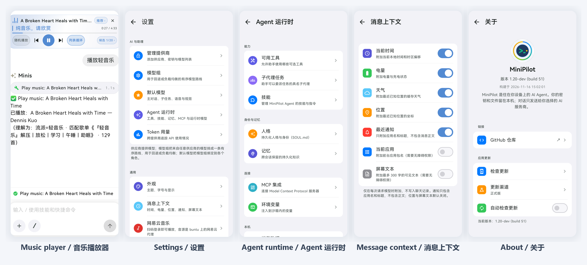

# MiniPilot

[](LICENSE)
[](#get-minipilot)

**A private, on-device AI agent for Android and iOS.**

**English** · [中文](README.zh-CN.md)

MiniPilot puts Claude, GPT, Gemini, OpenRouter and xAI models inside a native
mobile agent that has a real computer to work with: an Alpine Linux shell
running on the device, browser automation, skills, persistent memory, voice,
music, scheduled tasks and deep system integration. It is free and fully open
source under GPLv3.

MiniPilot is an **Android-first fork of [OpenMinis](https://github.com/OpenMinis/OpenMinis)**.
The Android line is where daily development happens — the current build is
`1.21-dev` (build 56). The iOS app remains in-tree and buildable; upstream
releases live at [openminis.app](https://openminis.app).

> **Compatibility contract** — MiniPilot keeps the identifiers that carry user
> data and deep links: the Android package `com.openminis.app` (perf builds use
> `.dev`), the `minis://` URL scheme, `/var/minis` paths and `minis-*` CLIs.
> Changing them would orphan existing sessions, skills and backups.

[**Download the Android APK**](https://github.com/zhrl55-svg/MiniPilot/releases) ·
[**Upstream iOS app**](https://apps.apple.com/app/id6759188481)



---

## What it does

| | |
|---|---|
| **Bring your own model** | Anthropic Claude, OpenAI (Chat Completions, Responses API, Azure), Google Gemini, OpenRouter and xAI, plus any OpenAI-compatible endpoint. API keys, and account sign-in where the provider supports it. |
| **A real Linux shell** | Alpine Linux runs on-device — PRoot on Android, iSH on iOS. Persistent shell, PTY, package installs, real files, mounted folders and `minis://` resources. |
| **Agent runtime** | Skills (`SKILL.md`), persona and persistent memory with hybrid retrieval, sub-agent helpers, scheduled runs, MCP servers over HTTP / SSE / STDIO, and risk-aware confirmation before destructive actions. |
| **Device integration** | Android: notifications, calendar, alarms, clipboard, media, accessibility-driven UI automation and optional Shizuku offloads. iOS: HealthKit, Calendar, Reminders, Contacts, HomeKit and more. |
| **Voice** | On-device SenseVoice speech recognition on Android, provider ASR/TTS, wake-word interaction, sentence-split read-aloud, and spoken confirmation for ambiguous commands. |
| **Web & knowledge** | Browser automation, Brave-backed web search, news, weather, stock quotes and 12306 train availability. |
| **Music** | A built-in NetEase-backed player docked above the chat, controllable by voice without leaving the conversation. |
| **Backup & portability** | Encrypted backup and restore of chats, files, providers and memories to SMB / WebDAV / SFTP / S3 / FTP via rclone; provider configuration import/export. |
| **Visibility** | Token usage per provider, in-app logs, local-only crash capture, and a JSON-RPC debug server in developer builds. |
| **20+ UI languages** | Including Simplified and Traditional Chinese, English, Japanese, Korean, German, French, Spanish, Portuguese, Russian and more. |

## What this fork adds

- **Android-first iteration.** Builds are exercised on physical devices, with an
  in-app stable/beta updater pointed at this repository's releases.
- **A distinct identity.** MiniPilot naming and the “Convergence” icon set on
  both platforms, while every compatibility identifier stays unchanged.
- **A simpler settings model.** Six top-level sections, with model setup split
  into Providers → Model Groups → Default Models → Runtime Models: reusable
  routing plans, the models each role uses, and the models the agent may switch
  to mid-task are now separate concepts.
- **Local capabilities.** Optional on-device assistant and ASR paths (MNN /
  SenseVoice on arm64), memory indexing with hybrid search, SkillStore retrieval,
  voice confirmation, notification summaries, accessibility automation and
  scheduled delivery.

Release notes on the [releases page](https://github.com/zhrl55-svg/MiniPilot/releases)
list the exact changes per build; this fork moves quickly.

## Get MiniPilot

### Android

- APK: [GitHub Releases](https://github.com/zhrl55-svg/MiniPilot/releases)
- Requires Android 8.0+ (API 26) on an **arm64-v8a** device
- Fork builds are `perf` builds, signed with the development key; back up before
  switching between arbitrary APKs

In-app updates check this repository and offer a stable channel, plus an optional
beta channel for prerelease builds. You can switch channels in **Settings → About**.

### iOS

There are no fork-specific iOS binaries. Build `src/ios` from source, or use the
upstream [OpenMinis app on the App Store](https://apps.apple.com/app/id6759188481).
The two share the same code base and compatibility identifiers, but the feature
set of a given build can differ.

## Build from source

Both platforms build a Linux sandbox inside the app, so native dependencies
(PRoot or iSH, FFmpeg, LAME, rclone) and the Alpine rootfs are built from source
rather than committed as binaries. A first build takes roughly 30–60 minutes;
later incremental builds are fast.

**→ Full toolchain notes and troubleshooting: [BUILDING.md](BUILDING.md)**
**→ Windows host notes: [WINDOWS-BUILD-AGENT.md](WINDOWS-BUILD-AGENT.md)**

### Android quick start

Requirements: **JDK 17**, Android SDK with **compileSdk 36** (**minSdk 26**),
**NDK r28+**, CMake 3.22.1, **Go 1.25+** with gomobile, plus `curl`, `tar`,
`make`, `awk`, `sed`. Only `arm64-v8a` is built.

```sh
git clone --recurse-submodules https://github.com/zhrl55-svg/MiniPilot.git
cd MiniPilot

./deps/build_proot.sh                  # PRoot + loaders → assets/ and jniLibs/
./scripts/prepare_android_sandbox.sh   # Alpine minirootfs → assets/
./deps/build_rclone_android.sh         # rclone.aar for backup remotes
mkdir -p src/android/app/libs
cp deps/build/rclone/rclone.aar src/android/app/libs/

cd src/android
./gradlew :app:assembleDebug           # debug APK
./gradlew :app:installDebug            # install on a connected device
```

For the device-friendly `perf` variant — `com.openminis.app.dev`, developer
tools enabled, profileable and non-debuggable — use `assembleGithubPerf` or
`installGithubPerf` instead.

### iOS quick start

Requirements: macOS with Xcode (iOS 26.2 SDK, Swift 6.0), the Metal Toolchain
(`xcodebuild -downloadComponent MetalToolchain`), `brew install ninja llvm
libarchive pkg-config`, Meson, and Go 1.25+.

```sh
./deps/build_lame.sh && ./deps/build_ffmpeg.sh
./deps/build_ish.sh && ./deps/prepare_alpine_rootfs.sh
./deps/build_rclone_ios.sh
open src/ios/Minis.xcodeproj
```

Build the **Minis** scheme for a device destination; the simulator needs natively
rebuilt dependencies. See BUILDING.md for the details and common failure modes.

### Build variants and tests

| Variant | Purpose |
|---|---|
| `debug` | Day-to-day development; developer tools enabled. |
| `perf` | Fork distribution build: `.dev` package, developer tools enabled, profileable, non-debuggable. |
| `release` | Minified; local release builds use the debug signing config. |

```sh
cd src/android
./gradlew :app:testDebugUnitTest       # JVM unit tests
./gradlew :app:connectedAndroidTest    # instrumented tests (device required)
```

## Repository layout

```
src/android/      Kotlin / Jetpack Compose app, PRoot sandbox, JNI, tools
src/ios/          Swift / SwiftUI app, iSH sandbox, share/widget/file-provider targets
src/shared/       Cross-platform assets and contracts (CLI, markdown, voice, backup)
deps/             Native dependency build scripts and vendored forks (proot, ish, ffmpeg, lame, rclone)
docs/specs/       Interface and architecture specs (minis://, debug server, hub, sandbox)
scripts/          Rootfs preparation and developer tooling
assets/           Brand assets, icons and previews
```

## Architecture at a glance

```
Compose UI / SwiftUI
        ↓
Agent loop: providers, skills, memory, MCP, scheduling, guards
        ↓
Tools:
  → PRoot (Android) / iSH (iOS) Alpine sandbox
  → native offloads (media, alarms, calendar, Shizuku, …)
  → device APIs (notifications, accessibility, clipboard, …)
  → browser automation
        ↓
Session storage + minis:// resources (SQLite, files, backups)
```

Model configuration is a chain, not a single setting: **Providers** add models,
**Model Groups** are reusable ordered routing plans, **Default Models** bind the
main chat, sub-tasks, voice input/output and vision to concrete models, and
**Runtime Models** are what the agent may switch to during a task.

Useful specs: [`minis://` URL scheme](docs/specs/minis-url-scheme.md),
[debug server API](docs/specs/debug-server-api.md),
[hub contract](docs/specs/hub-contract.md),
[iSH sandbox notes](docs/specs/ios-sandbox-ish-summary.md).

## Credits

MiniPilot stands on open-source work, and keeps upstream OpenMinis' GPLv3
licensing intact. The full inventory with versions and licenses is in
[THIRD_PARTY_LICENSES.md](THIRD_PARTY_LICENSES.md).

- **Sandbox** — [iSH](https://github.com/ish-app/ish) and
  [OpenMinis/ish-arm64](https://github.com/OpenMinis/ish-arm64) (GPLv3),
  [PRoot](https://github.com/termux/proot) and
  [OpenMinis/proot](https://github.com/OpenMinis/proot) (GPLv2),
  [Alpine Linux](https://alpinelinux.org).
- **Media & text** — [FFmpeg](https://ffmpeg.org) (LGPL-2.1+),
  [LAME](https://lame.sourceforge.io) (LGPL),
  [cppjieba](https://github.com/yanyiwu/cppjieba) (MIT),
  [KaTeX](https://katex.org) (MIT), [rclone](https://rclone.org) (MIT).
- **iOS** — SwiftAnthropic, SwiftMath, RealTimeCutVADLibrary (MIT),
  swift-cmark (BSD-2-Clause), and Apple / Swift Server packages (Apache-2.0).
- **Android** — AndroidX & Jetpack Compose, OkHttp, Coil, kotlinx, Reorderable,
  ACRA and Shizuku-API (all Apache-2.0 or MIT).

The upstream OpenMinis ecosystem:
[AwesomeMinis](https://github.com/OpenMinis/AwesomeMinis) for workflows and
[MinisSkills](https://github.com/OpenMinis/MinisSkills) for drop-in skills.

## License

[GNU General Public License v3.0](LICENSE). The app links iSH (GPLv3) and PRoot
(GPLv2), so the combined work is distributed under GPLv3. If you distribute a
build, publish your source and keep the bundled third-party licenses.

## Community & feedback

- **This fork** — bugs, build reports and feature requests:
  [GitHub Issues](https://github.com/zhrl55-svg/MiniPilot/issues)
- **Upstream** — [openminis.app](https://openminis.app),
  [OpenMinis/OpenMinis](https://github.com/OpenMinis/OpenMinis),
  [Telegram group](https://t.me/+2NzhOJuzRyI1YmM1)
